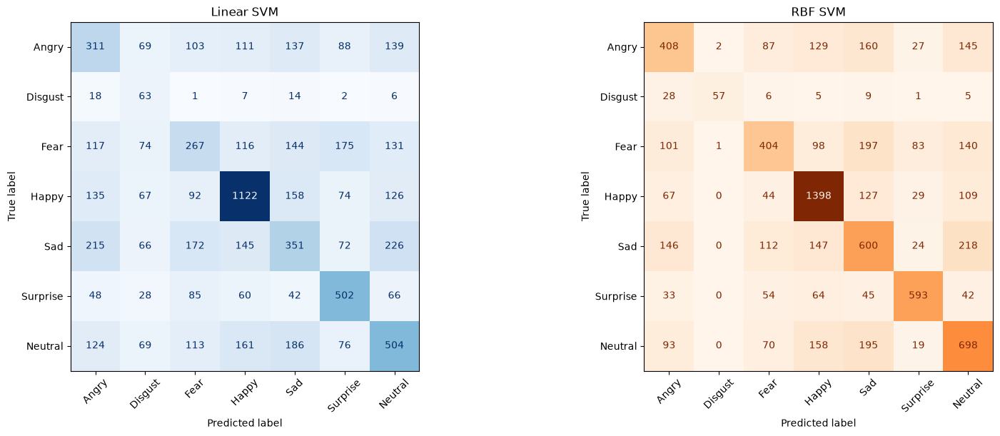

# RO11_Facial_Expression_Detection

*Team: Pierre Bordeau, Nathan Chandanson, Rémi Moshfeghi*

## Introduction

This repo contains the code of our team for the Facial Expression Detection project of course 5RO11 at ENSTA.

The webapp is a Streamlit application that provides a comparative benchmark between the models. It is avaialble at [this link](https://ro11facialexpressiondetection-cz3xv2eydyhhmqhogrntyn.streamlit.app/#facial-emotion-recognition-benchmark)

The training notebooks can be found in this repo, in the `main` branch. The training notebooks contains data about the training process and the training results. Some are also presented here

- [RO11\_Facial\_Expression\_Detection](#ro11_facial_expression_detection)
  - [Introduction](#introduction)
  - [Database used](#database-used)
  - [KNN - Nathan Chandanson](#knn---nathan-chandanson)
  - [CNN - Rémi Moshfeghi](#cnn---rémi-moshfeghi)
  - [HOG + SVM - Pierre Bordeau](#hog--svm---pierre-bordeau)

## Database used

The database used is FER-2013, which contains 48x48 pixel grayscale images of faces, with 7 emotions (anger, disgust, fear, happiness, sadness, surprise, neutral).

## KNN - Nathan Chandanson

## CNN - Rémi Moshfeghi

## HOG + SVM - Pierre Bordeau

The implementation and training results are in the `hog_svm.ipynb` notebook.

We first used HOG + Linear SVM. We first used the L2-Hys normalization method, but we saw that the results were better with juste the classic L2 norm for the HOG descriptor. 

The results with this model were mixed, the accuracy is 43.47% on the validation set. The confusion matrix is shown below. One advantage of the model is that the prediction is very fast, even counting the HOG descriptor computation.

We also tried to use a RBF SVM. The results were better (57.93% accuracy on the validation set), but the model is much bigger (817MB), the training was much longer, and the prediction is also well slower. The confusion matrix is shown below.

